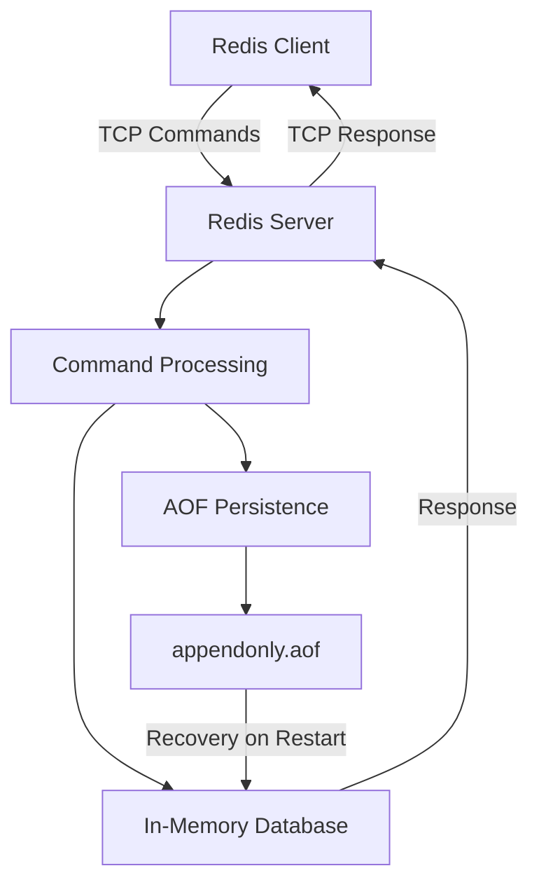

# Hi, I'm Antima 👋

### IT Student | Java Developer | Robotics & IoT Enthusiast

I'm a final-year B.Tech Information Technology student interested in building practical software solutions, robotics applications, and IoT-based systems.

I enjoy learning new technologies, solving problems, and developing projects that combine software with real-world applications.

## 👩‍💻 About Me

- 🎓 B.Tech in Information Technology
- 💻 Interested in Java Development and Software Engineering
- 🤖 Robotics Software Developer Intern at Anzo Controls
- 🔧 Worked with ROS2 and a 6-axis industrial robot
- 🌐 Interested in IoT, AI, Robotics, and Automation
- 🚀 Currently developing MiniRedis, a Redis-inspired database in Java

## 🛠️ Technical Skills

**Programming Languages**
- Java
- C
- C++

**Technologies & Tools**
- ROS2
- Git and GitHub
- Apache Maven
- TCP Socket Programming
- JUnit 5

## 🚀 Featured Projects

### MiniRedis
A Redis-inspired in-memory key-value database built using Java.

- TCP client-server communication
- AOF-based data persistence and recovery
- Key expiration and TTL support
- Multithreaded client handling
- Automated unit and integration tests

[View MiniRedis on GitHub](https://github.com/Antima1302/MiniRedis)

### Automatic Smart Curtain Control System
An ESP32-based automation project designed to control curtains using automatic and manual modes.

### Radar System Using Servo Motor
A sensor-based radar demonstration using an ultrasonic sensor and servo motor.

## 📚 Currently Learning

- Advanced Java Development
- Data Structures and Algorithms
- Software Engineering
- Robotics and IoT Applications

## 📫 Connect With Me

- GitHub: [@Antima1302](https://github.com/Antima1302)

---

*Always learning, building, and improving.* 🚀

## System Architecture

